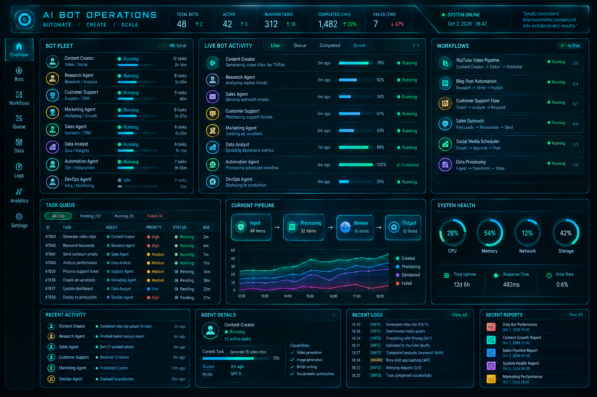

# Bot Ops Blue

A borderless desktop operations dashboard for a fleet of bots,
written in Ruby with [Shoes 3.3 "Walkabout"](https://github.com/shoes/shoes3).
It reproduces the reference mock-up in `assets/reference-mockup.png`: bot
fleet, live activity, workflows, task queue, pipeline chart, system health
gauges, recent activity, agent details, logs and reports, plus a sidebar that
switches between full-size pages for each area.



`assets/preview-mock-render.png` shows the same layout drawn by the test
harness (a Shoes DSL stand-in that records drawing calls as SVG). It is not a
Shoes screenshot, but it exercises every panel, page and timer path.

## Running it

1. Install Shoes 3.3.x for your platform from the
   [shoes3 releases](https://github.com/shoes/shoes3/releases) (macOS `.dmg`,
   Linux `.install` script, Windows `.exe`). Shoes bundles its own Ruby, so
   nothing else is needed.
2. Launch the app:

   ```sh
   shoes bot_ops_hub.rb            # Linux / Windows (shoes on PATH)
   open -a Shoes bot_ops_hub.rb    # macOS, or drag the file onto Shoes.app
   ```

The window opens without an OS title bar (`decorated: false`). Drag the header
bar to move it. The three glyphs in the top-right corner restore the title bar,
toggle fullscreen, and quit. The same controls live on the **Settings** page.

## Layout of the code

| File | Role | Toolkit |
| --- | --- | --- |
| `bot_ops_hub.rb` | Entry point: opens the Shoes window and boots the hub | Shoes |
| `lib/bot_ops/hub.rb` | Header, sidebar, pages, drag-to-move, refresh loop | Shoes |
| `lib/bot_ops/panels.rb` | Drawing for each dashboard panel | Shoes |
| `lib/bot_ops/widgets.rb` | Primitives: panels, bars, donuts, line chart, tabs | Shoes |
| `lib/bot_ops/store.rb` | All dashboard state plus the event API that updates it | none |
| `lib/bot_ops/comms.rb` | Channel interface and the built-in simulator | none |
| `lib/bot_ops/layout.rb` | Pixel geometry of every panel | none |
| `lib/bot_ops/theme.rb` | Palette and typography | none |

Only the three Shoes files touch the toolkit. If Shoes ever has to be swapped
for something else (GTK via ruby-gnome, libui, or a Rust UI driven through
Rutie), the store, comms, layout and theme carry over unchanged.

## Adding comms

The UI never mutates state directly. Everything flows through
`BotOps::Store#apply(event)`, where an event is a plain hash with a `type`
key. A comms channel is any object that queues such hashes; the hub drains
channels from a Shoes timer every two seconds so all drawing stays on the
main thread.

```ruby
class SocketChannel < BotOps::Comms::Channel
  def start(_store)
    @thread = Thread.new do
      TCPSocket.open("127.0.0.1", 9000) do |sock|
        sock.each_line { |line| push(JSON.parse(line)) }
      end
    end
  end

  def stop
    @thread && @thread.kill
  end
end
```

Then boot the hub with it in `bot_ops_hub.rb`:

```ruby
boot(BotOps::Store.new, BotOps::Comms::Multiplexer.new(SocketChannel.new, BotOps::Comms::SimulatedChannel.new))
```

Supported event types (see `Store#apply`):

| `type` | Fields |
| --- | --- |
| `progress` | `bot_id`, `progress` (0-100) |
| `activity.add` / `activity.status` | `bot_id`, `task`, `progress`, `status` |
| `bot.status` | `bot_id`, `status`, `tasks` |
| `task.add` / `task.status` | `id`, `title`, `agent`, `priority`, `status` |
| `workflow` | `id`, `done`, `status` |
| `log` | `level` (INFO/WARN/ERROR), `message` |
| `event` | `bot_id`, `message` |
| `health` | `cpu`, `memory`, `network`, `storage`, `response_ms`, `error_rate` |
| `pipeline` | `input`, `processing`, `review`, `output` |
| `series.push` | `label`, `values` (`created`, `processing`, `completed`, `failed`) |
| `stat` | `label`, `value`, `delta`, `delta_dir`, `delta_color` |
| `agent.detail` | `bot_id`, `task`, `progress`, `started_at`, `model`, `capabilities` |
| `system` | `online` |
| `fleet.total` | `total` |
| `tick` | `seconds` |

## Notes on Shoes

* Window styles used: `decorated: false`, `resizable: false`, plus the
  runtime `app.decorated=`, `app.fullscreen=`, `app.move`, `app.left/top`.
  These exist in Shoes 3.3.4 and later (not in Shoes 4 or Scarpe).
* Everything is absolutely positioned inside slots, so the layout does not
  depend on font metrics. Text that could overflow a column is clipped.
* Live panels are redrawn with `slot.clear { ... }`; static ones (workflows,
  reports, settings) are drawn once.
