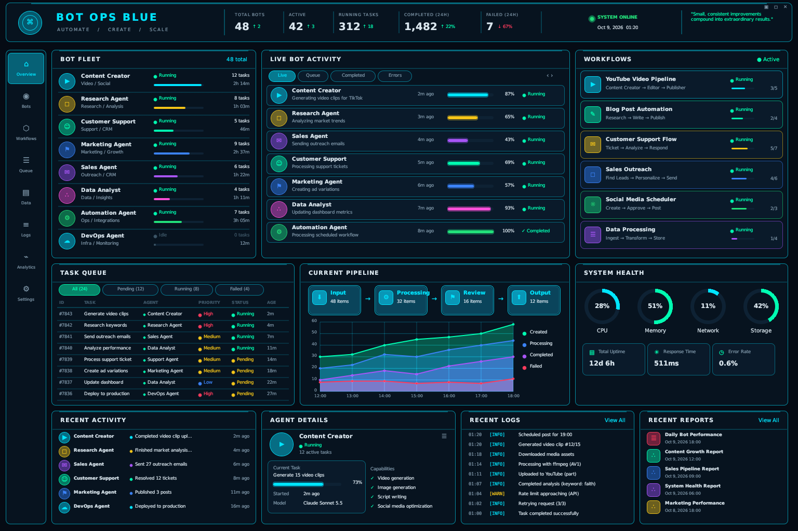

# Bot Ops Blue

A borderless desktop dashboard for your **live Claude Code sessions**, on
this machine and on any other machine that runs the small reporting agent.
Ruby owns the data, layout and comms; a small Rust extension owns the window
and rendering. The look follows the mock-up in `assets/reference-mockup.png`:
live sessions, live activity, projects, tool calls, hourly usage, machine
health, recent prompts, session details, an event log and a machine list,
plus a sidebar that switches between full-size pages for each area.

Nothing on screen is simulated. Panels with no data show an empty state.

The window itself, fullscreen on a 2560x1440 monitor (its own snapshot, see
`BOT_OPS_SNAPSHOT_DIR` below):



## Setup

You need Ruby 3.0+ and a Rust toolchain ([rustup.rs](https://rustup.rs), one
command on macOS, Linux and Windows). Then:

```sh
bundle exec rake setup   # bundle install + cargo build of the native window
bundle exec rake run     # start the dashboard
```

`rake setup` prints what to install if `cargo` is missing. No GUI toolkit,
no system packages: the window is pure Rust ([egui](https://github.com/emilk/egui)
/ eframe) and the fonts are bundled in the extension.

Other tasks:

| Task | What it does |
| --- | --- |
| `rake test` | Minitest suite over the store, comms, scene and frame protocol (no display or Rust needed) |
| `rake preview` | Renders every page to SVG in `tmp/preview/` (no display or Rust needed) |
| `rake compile` | Rebuilds just the native extension |
| `rake clean` | Removes build artifacts |

### Which monitor

On macOS the window opens centered on your external monitor. If no external
monitor is connected it refuses to start rather than cover the main screen.
To choose a different spot, set an environment variable:

| Variable | Effect |
| --- | --- |
| `BOT_OPS_DISPLAY=external` | First non-main monitor (default); exits if there is none |
| `BOT_OPS_DISPLAY=main` | Leave placement to the OS (main monitor) |
| `BOT_OPS_DISPLAY=2` | Monitor number 2, in macOS's screen order |
| `BOT_OPS_POSITION=x,y` | Exact top-left corner in screen points (any OS) |

```sh
BOT_OPS_DISPLAY=main bundle exec rake run
```

`BOT_OPS_FULLSCREEN=1` starts fullscreen on that monitor (macOS's own
fullscreen, in its own Space).

The window opens without an OS title bar. Drag the header bar to move it,
and the grip in the bottom-right corner to resize it (down to 768x512); the
panels zoom and stretch to fill whatever size it is.
The three buttons at the right of the header minimize (leaving fullscreen
first if needed), enter or leave fullscreen, and quit. The **Settings** page
has the same controls plus a title-bar toggle.
Click a tool call, prompt, event-log line, machine, or a live session's
last tool for the full detail in a box over the dashboard. Text is shown
exactly as written, never wrapped (code's indentation means something), so
drag inside the box or swipe sideways to read long lines; it also scrolls
up and down, and Esc, its X or a click outside closes it. Full text (a tool's whole input, a
prompt, an error) is kept for this machine's sessions only; other machines
and cloud sessions send short excerpts.

More of the dashboard opens a breakdown the same way:

- **Header stats and the Usage tiles:**
  - Output tokens: by model, project, hour and session, with input and cache tokens and the cache-hit ratio.
  - Tool calls: by tool, with error rate, median and slowest duration.
  - Prompts: by project.
  - Live sessions: every session.
- **The usage chart:**
  - Click a column for that hour's or day's breakdown.
  - Click a legend entry to hide or show its line.
  - Pick 12h, 24h, 7d or 30d. The range and hidden lines are remembered in `~/.config/bot-ops-blue/prefs.json`.
- **A project card:** its sessions, branches, output by model and the files edited most.
- **Timeline** (in Session Details): the selected session's prompts, tool calls with durations, and errors in order. Session Details also shows the context against the model's window, yellow from 80% and red from 95%.

Keys: **/** searches prompts, tool calls and events; **Up/Down** move
through sessions (or the search results); **Enter** opens the selected
session's timeline (or the search result); **Esc** closes what's open.
"this session only", in the Tool Calls and Event Log title bars, narrows
them to the selected session.

When a session waits on you (a permission prompt, with the hook installed),
the Dock icon shows how many are waiting and bounces once. A macOS
notification can be turned on in Settings; it's off by default because a
script-posted notification opens Script Editor when clicked.

Hourly usage from every source is saved to
`~/.config/bot-ops-blue/history.json` for 30 days, so the 7d and 30d ranges
include cloud sessions and other machines, which report only their last
24 hours. This machine's own transcripts are read back 7 days at startup.

In fullscreen macOS slides its menu bar over the top edge once the pointer
rests there, and a click under it goes to the menu bar rather than to the
window controls beneath; move the pointer away and back, or use the keys:
**Esc** leaves fullscreen, **F11** or **Ctrl+Cmd+F** toggles it.

The layout stretches to the window: the content is zoomed until the
1536x1024 design fits, and the panels widen or grow taller to use the rest,
so a 16:9 monitor is filled edge to edge without black bars.

## Where the data comes from

`BotOps::Probe` reads Claude Code's own files on the machine it runs on.
It sends nothing anywhere and changes no settings:

| Source | Gives |
| --- | --- |
| `~/.claude/sessions/<pid>.json` (pid checked alive) | live sessions: name, cwd, status (busy/idle), entrypoint, version |
| transcripts without a live process | **earlier** sessions from the last 12h (e.g. VS Code conversations you have moved on from), listed below the live ones |
| `~/.claude/projects/*/<session>.jsonl` (+ `subagents/`) | model, tokens, context size, tool calls and errors, prompts, title, git branch |
| `sysctl`, `vm_stat`, `df` (macOS) or `/proc` (Linux) | load, memory, disk, uptime |

Transcripts are tailed: the first scan reads the last 24 hours, then each
one-second refresh reads only the lines appended since. These files are
Claude Code internals, not a published API, so every field is read
defensively and a format change shows up as missing data, never as wrong
data. `claude agents --json` lists the same live sessions if you want to
cross-check.

### Hooks (optional)

`bin/bot-ops-hook` is a Claude Code command hook that appends
SessionStart, SessionEnd, Notification and Stop events to
`~/.claude/bot-ops/hooks.jsonl`. With it registered, a session blocked on a
permission prompt shows **Needs you** (yellow, sorted first) within a
second or two, and starts, ends and finished turns appear in the event log. It
prints nothing, always exits 0 and caps its log at 2 MB. Register it yourself
for those four events (for example with `/hooks`) as
`ruby /path/to/bot-ops-blue/bin/bot-ops-hook`; the Settings page shows
whether events are arriving.

### Adding other accounts and machines

The probe only reads the account it runs as. Sessions from another macOS
account on the same Mac (for example a VS Code window logged in as a
different user), or from another machine, reach the dashboard through
`bin/bot-ops-agent`, run as that account, posting to the dashboard's
collector. Sources are keyed `user@host`, so accounts sharing a Mac show up
separately.

On the account showing the dashboard:

```sh
bundle exec rake token                       # creates ~/.config/bot-ops-blue/token (0600)
BOT_OPS_LISTEN=127.0.0.1:47800 bundle exec rake run   # same Mac only
BOT_OPS_LISTEN=0.0.0.0:47800 bundle exec rake run     # LAN / Tailscale
```

In each other account or machine, with a checkout of this repo and any Ruby
2.6+ (macOS's built-in `/usr/bin/ruby` works, no gems needed), put the same
token in `~/.config/bot-ops-blue/token` (or `BOT_OPS_TOKEN`) and run:

```sh
bin/bot-ops-agent                                         # same Mac
BOT_OPS_COLLECTOR=http://<dashboard-host>:47800 bin/bot-ops-agent   # elsewhere
```

The agent posts a snapshot every 3 seconds (`BOT_OPS_INTERVAL`). A source
that stops reporting turns offline after 15 seconds and its sessions leave
the live views. Snapshots carry prompt excerpts and tool details over plain
HTTP, guarded only by the token, so keep the port on loopback or a network
you trust (LAN, Tailscale, or an SSH tunnel), not the open internet.

### Cloud sessions (claude.ai/code)

Claude Code has no API that lists cloud sessions, so they report
themselves: the cloud environment's setup script installs a small hook on
every session VM, which posts trimmed events (prompt excerpts, tool names;
never file contents) through an ngrok tunnel to the collector. Cloud
sessions then appear as the `claude.ai` source with a ☁ label.

**Step-by-step guide, with screenshots: [docs/cloud-sessions.md](docs/cloud-sessions.md).**

## How it is put together

```
bot_ops_blue.rb             entry point
bin/bot-ops-agent           reports another machine to the dashboard
cloud/                      cloud reporter, its setup script, hook settings, ngrok policy
docs/                       guides (cloud sessions)
themes/                     colour themes, one YAML file each (standard-blue.yml is the default)
lib/bot_ops/
  store.rb                  all dashboard state + Store#apply(event)
  probe.rb                  reads this machine's Claude Code sessions + health
  collector.rb              HTTP endpoint for other machines' snapshots + cloud events
  cloud_feed.rb             turns cloud hook events into the claude.ai source
  comms.rb                  Channel interface, Multiplexer, ClaudeChannel
  display.rb                picks the monitor the window opens on
  scene.rb                  builds a frame from the Store; handles clicks
  theme.rb                  loads themes/<slug>.yml; every colour comes from the one in use
  panels.rb, widgets.rb     drawing of each panel, on top of Canvas
  canvas.rb                 toolkit-independent display list (+ JSON, + SVG)
  layout.rb                 geometry
  native_host.rb            Ruby side of the Ruby <-> Rust protocol
ext/bot_ops_native/         Rust crate: egui window, renderer, Rutie binding
```

The Ruby side never touches a GUI API. `Scene#build` produces a `Canvas`:
a list of drawing commands (rounded rects, circles, lines, wedges, chart
areas, text) plus clickable hit regions. The native side asks for a frame on
every repaint and gets JSON back only when something changed, so idle
repaints cost nothing on the Ruby side.

### The Ruby <-> Rust protocol

`BotOps::Native.run(host, width, height, title, position)` blocks until the window
closes. While it runs, Rust calls two methods on `host`:

| Call | Returns |
| --- | --- |
| `host.poll` | JSON frame (`cmds`, `hits`, `drag`, `bg`) when something changed, else `""` |
| `host.hit(id)` | A window command for hit region `id`: `"quit"`, `"fullscreen:toggle"`, `"decorations:toggle"`, or `""` |
| `host.key(code)` | `"handled"` when Ruby used the key (27 Esc, 38/40 Up/Down, 13 Enter, 8 Backspace), else `""` |
| `host.text(str)` | Typed text (`/` opens search; while searching, it's the query) |

A frame's `badge` is the number of sessions waiting on the person; Rust
shows it on the Dock icon and bounces the icon when it goes up. Its `bg` is
the theme's window background, which Rust fills before drawing.

Rust handles the drag region (the header) natively, draws the frame, and
executes the window commands. Everything else, including the two-second
refresh tick, lives in Ruby (`BotOps::NativeHost`).

### Themes

Every colour the dashboard draws comes from a theme file, so the look can
be changed without touching the code. `themes/standard-blue.yml` is the
default, **Standard Blue**, and the fallback for anything another theme
leaves out. Pick a theme from the drop-down on the **Settings** page; the
choice is kept in `~/.config/bot-ops-blue/prefs.json`. `BOT_OPS_THEME=<slug>`
overrides it for one run (`rake run` and `rake preview` both honour it).

A theme is one YAML file, `themes/<slug>.yml` in the checkout or
`~/.config/bot-ops-blue/themes/<slug>.yml` outside it, with a `name:` and
`colors:` (the palette, surfaces and text, plus named roles such as the
sidebar's active button), a `series:` list for charts, and the tables
`status`, `priority`, `levels`, `tools`, `kinds` and `usage` that colour
sessions, log lines, tool calls, event-log entries and the usage chart's
lines. Any value is `"#RRGGBB"` or the name of another colour, so a theme
can swap one hue in one place. Only the keys Standard Blue defines are
accepted; a malformed file is reported on stderr and the previous theme
stays. Once a theme has images of its own, they will live in a folder named
after it (`themes/<slug>/`).

To make one, start from a scratch copy of Standard Blue:

```sh
bundle exec rake theme:custom      # writes themes/custom.yml (git ignores it)
```

Pick **Custom** on the Settings page and edit the file while the dashboard
runs: it reloads the theme as you save. Standard Blue itself is never
edited, so it always survives. When the look is done, save the file as
`themes/<name>.yml` with its own `name:`.

### Look, fonts and icons

Panels are drawn from a few primitives the native side renders with egui:

- gradient fills (convex shapes whose vertex colours follow the gradient, with an anti-aliased edge)
- soft glows (egui's blurred shadow shape)
- fading chart areas
- lines with round ends

Edge highlights are gradients that peak in one place and fade to nothing toward the corners.

- **Text:** [Inter](https://github.com/rsms/inter), with [Montserrat](https://github.com/JulietaUla/Montserrat) ExtraBold for the title. Both are under the SIL Open Font License (`ext/bot_ops_native/fonts/*-LICENSE.txt`). DejaVu Sans Mono is used for code, with DejaVu Sans as a fallback for symbols.
  - `lib/bot_ops/font_metrics.rb` holds each font's character widths, so Ruby can truncate and place text by its real width.
  - Regenerate it with `bundle exec rake metrics` after changing a font.
- **Icons:** [Lucide](https://lucide.dev) (ISC license), flattened to polylines in `lib/bot_ops/icons.rb`. The Visual Studio Code mark comes from [Simple Icons](https://simpleicons.org) (CC0); the logo is a Microsoft trademark.
  - Regenerate with `bundle exec rake icons`. This needs the network; the generated file is committed.

To check what the window really draws without screen-recording permission, start the app with `BOT_OPS_SNAPSHOT_DIR` set to a folder. Creating `request` in that folder makes the window save its own frame there as `window.png`.

### Why Rutie, and which version

The extension is bound with [Rutie](https://github.com/danielpclark/rutie).
Rutie releases track Ruby's special-constant layout, so the version has to
match the Ruby in use: `rutie = "0.13.3"` for Ruby 3.2 to 3.4 (what
`Cargo.toml` pins), `0.14` for Ruby 4.0. Using 0.9 with Ruby 3 segfaults the
first time a `nil` crosses the boundary, which is why the host protocol only
exchanges strings and integers.

The binding uses Rutie's `derive` feature: `BotOps::Native` is a
`#[rubymodule]` whose `run` is an ordinary Rust function with typed
parameters, so a wrong argument raises `TypeError` in Ruby instead of being
silently defaulted. The window loop runs under `Thread::call_without_gvl`;
0.13.2 fixed that call freeing its unblock function after Ruby's first
interrupt (the crate used to call `rb_thread_call_without_gvl` itself to
avoid the crash).

## Adding comms

Everything flows through `BotOps::Store#apply(event)`, where an event is a
plain hash with a `type` key. A comms channel is any object that queues such
hashes; the host drains channels from the refresh tick on the main thread.

```ruby
class SocketChannel < BotOps::Comms::Channel
  def start(_store)
    @thread = Thread.new do
      TCPSocket.open("127.0.0.1", 9000) do |sock|
        sock.each_line { |line| push(JSON.parse(line)) }
      end
    end
  end

  def stop
    @thread && @thread.kill
  end
end
```

Then boot the dashboard with it in `bot_ops_blue.rb`:

```ruby
channel = BotOps::Comms::Multiplexer.new(SocketChannel.new, BotOps::Comms::ClaudeChannel.new)
BotOps::NativeHost.new(channel: channel).launch
```

Supported event types (see `Store#apply`):

| `type` | Fields |
| --- | --- |
| `snapshot` | `snapshot` (a `Probe#snapshot` hash), `local` (true for this machine) |
| `collector` | `status` (text shown in the header and on Settings) |
| `probe.error` | `message` |

## Platform notes

- **Linux**: needs an X11 or Wayland session with OpenGL (any desktop has
  it). On a bare container add `libxkbcommon-x11-0`.
- **macOS**: the extension is installed as `bot_ops_native.bundle`; Rutie
  links against the Ruby you build with, so use the same Ruby to run.
- **Windows**: build from a shell where `cargo` and `ruby` are on `PATH`
  (RubyInstaller + rustup). The DLL is installed as `bot_ops_native.so`,
  which is the extension Ruby expects there.
- **macOS, fullscreen on a second display**: until the window loses and
  regains focus, winit reports clicks in screen coordinates (the events
  arrive without a window), so every click missed by the display's offset
  and the header controls seemed dead. The native host places each press by
  AppKit's own cursor location instead; `BOT_OPS_DEBUG=1` logs both when
  they disagree.

## Contributing

Pull requests are triaged by an AI reviewer before a person reads them, so
the description has to carry everything needed to judge the change without
running it:

- **Before and after screenshots** for anything visible, cropped to the
  panel or control that changed, taken from the real window rather than
  the SVG preview (the preview understates egui's glow and blends). Start
  the dashboard with `env BOT_OPS_SNAPSHOT_DIR=/some/dir bundle exec rake run`,
  then `touch /some/dir/request`: the window writes its current frame to
  `/some/dir/window.png`.
- **Full details of the change**: what was wrong or missing, what the
  change does and why that approach, every file touched and why, and what
  you checked (`rake test`, `rake preview`, the window itself, on which
  monitor and at what size).
- One change per pull request, with a commit message that gives the reason,
  not just the what.
- Colour, icon and image experiments go in a Custom theme (see Themes),
  never in `themes/standard-blue.yml`. A new look is a new theme file.

A PR without the screenshots or the details is sent back for them before
review.

Unless you explicitly state otherwise, any contribution intentionally
submitted for inclusion in the work by you, as defined in the Apache-2.0
license, shall be dual licensed as below, without any additional terms or
conditions.

## License

Licensed under either of

- Apache License, Version 2.0 ([LICENSE-APACHE](LICENSE-APACHE) or
  http://www.apache.org/licenses/LICENSE-2.0)
- MIT license ([LICENSE-MIT](LICENSE-MIT) or
  http://opensource.org/licenses/MIT)

at your option.

Bundled third-party work keeps its own license: the Inter and Montserrat
fonts (SIL Open Font License) and the DejaVu fonts (Bitstream Vera
license), all with their notices in `ext/bot_ops_native/fonts/`; the
Lucide icons (ISC) and the Visual Studio Code mark from Simple Icons
(CC0), both in `lib/bot_ops/icons.rb`.

