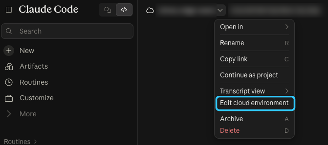
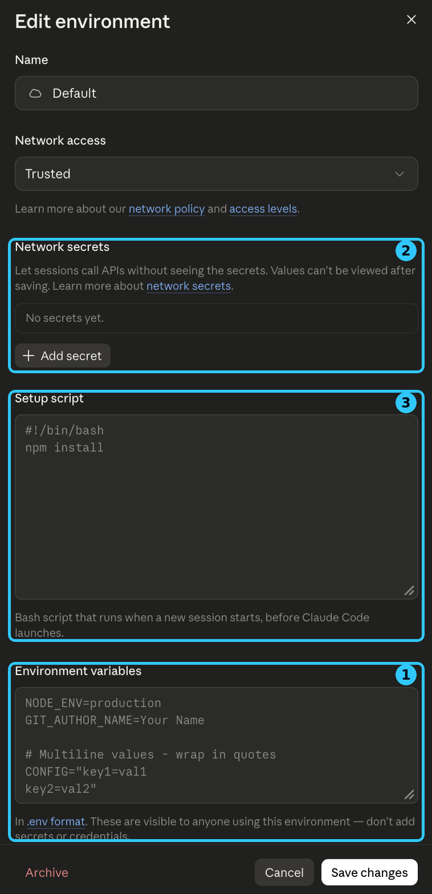

# Showing claude.ai/code cloud sessions on Bot Ops Blue

Bot Ops Blue reads Claude Code sessions on your own machine straight from
disk. Cloud sessions, the ones you run at [claude.ai/code](https://claude.ai/code),
run on Anthropic-hosted virtual machines, and Claude Code has no API that
lists them. So cloud sessions report themselves: a small hook on each cloud
VM posts what the session is doing to your dashboard through a tunnel.

This guide sets that up once for a cloud environment. After that, every
cloud session in that environment shows up on the dashboard, in any
repository, with nothing committed to the repositories themselves.

- [How it works](#how-it-works)
- [What you need](#what-you-need)
- [1. Run the dashboard with its collector](#1-run-the-dashboard-with-its-collector)
- [2. Open a tunnel with ngrok](#2-open-a-tunnel-with-ngrok)
- [3. Open your cloud environment's settings](#3-open-your-cloud-environments-settings)
- [4. Fill in the environment](#4-fill-in-the-environment)
- [5. Check that it works](#5-check-that-it-works)
- [Existing cloud sessions](#existing-cloud-sessions)
- [What leaves a cloud session](#what-leaves-a-cloud-session)
- [Troubleshooting](#troubleshooting)
- [Other ways to connect](#other-ways-to-connect)

## How it works

```
 claude.ai/code session VM               Anthropic agent proxy      ngrok edge                 your machine
┌──────────────────────────┐   POST    ┌────────────────────┐    ┌────────────────────┐    ┌──────────────────────┐
│ Claude Code hook         │ /v1/event │ adds the network   │    │ 404 unless a       │    │ collector            │
│ ~/.claude/hooks/         ├──────────►│ secret:            ├───►│ collector path     ├───►│ 127.0.0.1:47800      │
│   bot-ops-report.py      │           │ Authorization:     │    │ basic auth checked │    │ checks the token     │
│ (installed by the        │           │   Basic …          │    │ here               │    │ again → dashboard    │
│  environment setup       │           └────────────────────┘    └────────────────────┘    └──────────────────────┘
│  script)                 │
└──────────────────────────┘
```

- **The setup script** of your cloud environment installs the reporter
  (`cloud/bot-ops-report.py`) as a Claude Code hook on every new session VM.
  It runs before Claude Code starts, so it covers every repository you open.
- **The reporter** runs on session start and end, each prompt, each tool
  call, permission prompts and finished turns. It trims each event (see
  [what leaves a cloud session](#what-leaves-a-cloud-session)) and posts it
  from a background process, so it never slows a session down. It does
  nothing unless `CLAUDE_CODE_REMOTE` is `true`, which Claude Code sets
  only in cloud sessions, and `BOT_OPS_URL` is set. Despite its name,
  `CLAUDE_CODE_REMOTE` is the cloud-session marker, not Remote Control.
- **A network secret** holds the tunnel's password. Anthropic's agent proxy
  attaches it to requests for your tunnel's host after they leave the VM, so
  the password is never visible inside the session.
- **ngrok** gives your machine a stable public HTTPS address. Its traffic
  policy rejects anything without the password, and anything outside the
  collector's three paths, before it reaches you.
- **The collector** in the dashboard listens on loopback only, checks the
  password again, and turns the events into a `claude.ai` source: cloud
  sessions appear with a ☁ **Cloud** label, sorted in with your local ones.
  It keeps 24 hours of cloud events in
  `~/.config/bot-ops-blue/cloud-events.jsonl`, so they survive a restart.

## What you need

| | |
| --- | --- |
| Claude plan | **Pro or Max**. Network secrets aren't available on Team or Enterprise yet; see [without network secrets](#without-network-secrets). |
| Bot Ops Blue | Set up and running ([README](../README.md#setup)). |
| ngrok | A free account, the `ngrok` agent installed, and the free **static domain** that comes with the account. |
| Cloud VM | Nothing to install: Python 3, which the reporter uses, is preinstalled on claude.ai/code VMs. |

## 1. Run the dashboard with its collector

The collector is off unless you ask for it. Create its token once, then
start the dashboard with the collector on loopback:

```sh
bundle exec rake token        # writes ~/.config/bot-ops-blue/token (mode 0600)
BOT_OPS_LISTEN=127.0.0.1:47800 bundle exec rake run
```

Keep it on `127.0.0.1`: the tunnel reaches it locally, and nothing else
needs to.

## 2. Open a tunnel with ngrok

**Ports**

| Piece | Address | Notes |
| --- | --- | --- |
| Collector | `127.0.0.1:47800` | Loopback only. Change it with `BOT_OPS_LISTEN`. |
| ngrok agent | outbound TCP 443 to ngrok | No inbound ports, router forwarding or firewall changes. |
| Public URL | `https://<your-domain>` on 443 | Forwards to `http://127.0.0.1:47800`. |
| ngrok inspector | `127.0.0.1:4040` | Turned off (`--inspect=false`): it would record prompt excerpts. |

**Steps**

1. Connect the agent to your account (the authtoken is on the ngrok
   dashboard's *Your Authtoken* page):

   ```sh
   ngrok config add-authtoken <your-authtoken>
   ```

2. Find your free static domain on the ngrok dashboard (under *Domains*).
   It looks like `something-random.ngrok-free.dev`. A static domain matters:
   the cloud environment stores it, so it must not change between runs.

3. Generate the traffic policy:

   ```sh
   bundle exec rake ngrok:policy
   ```

   This writes two files, both mode 0600, both secret. Never commit them:

   | File | Contents |
   | --- | --- |
   | `~/.config/bot-ops-blue/ngrok-policy.yml` | The filled-in [`cloud/ngrok-policy.example.yml`](../cloud/ngrok-policy.example.yml): a 404 for any path other than `/v1/event`, `/v1/snapshot` and `/v1/health`, then HTTP basic auth whose password is your collector token. |
   | `~/.config/bot-ops-blue/ngrok-basic-auth` | `botops:<collector token>`, used for the network secret in step 4. |

   The policy uses only actions that ngrok's free plan allows. Rewriting
   headers would need a paid plan, which is why the password is the
   collector token itself rather than being swapped for it at ngrok's edge.

4. Start the tunnel:

   ```sh
   bundle exec rake ngrok:tunnel DOMAIN=<your-domain>
   ```

   The tunnel has to be running whenever you want cloud sessions on the
   dashboard. To start it automatically, have your shell or login items run
   the same `ngrok http` command the task prints, guarded so that a second
   copy isn't started while one is running. ngrok refuses a second agent on
   the same domain with `ERR_NGROK_334`.

## 3. Open your cloud environment's settings

At [claude.ai/code](https://claude.ai/code), open any cloud session, click
the arrow next to the session's title at the top, and choose **Edit cloud
environment**:



This edits the environment the session runs in (often **Default**), not just
that session. Every session started in the environment gets these settings.

## 4. Fill in the environment

The **Edit environment** dialog has the three sections you need, numbered
in the order to fill them:



Leave **Network access** on **Trusted**. Sessions can reach a network
secret's hosts even where the access level wouldn't otherwise allow them.

### ① Environment variables

Add one line, your tunnel's URL:

```
BOT_OPS_URL=https://<your-domain>
```

Put only the URL here. As the dialog says, anyone who can use the
environment can read these values.

### ② Network secrets

Select **Add secret** and fill in:

| Field | Value |
| --- | --- |
| Credential type | **Bearer** (the default) |
| Name | Anything, e.g. `Bot Ops Blue collector` |
| Allowed websites | `<your-domain>`, with no `https://` and no path |
| Custom headers → Name | `Authorization` |
| Custom headers → Prefix | `Basic` (change it from `Bearer`) |
| Custom headers → Value | the output of the command below |

```sh
ruby -e 'print [File.read(File.expand_path("~/.config/bot-ops-blue/ngrok-basic-auth")).strip].pack("m0")'
```

Select **Connect**. The secret is saved straight away and can't be viewed
again. To change it later, delete it and add it again.

### ③ Setup script

Replace the placeholder with the whole of [`cloud/setup.sh`](../cloud/setup.sh).
On macOS, copy it to the clipboard with:

```sh
pbcopy < cloud/setup.sh
```

The script installs the reporter as a user-level hook on the session VM and
merges it into any existing `~/.claude/settings.json` there.

> **Note.** Claude Code's documentation describes hosted cloud sessions
> running hooks "from the repository and from your organization's
> server-managed settings"; a user-level settings file written on the VM by
> the setup script isn't mentioned either way. Step 5 confirms it for your
> environment, and [per-repository hooks](#per-repository-hooks) are the
> documented alternative if it doesn't. It embeds the
reporter, so it downloads nothing, and every step is best-effort, so it can
never stop a session from starting. If you already have a setup script,
append this one to it.

Then select **Save changes**.

## 5. Check that it works

**The tunnel.** These should answer `401`, `404` and `200`:

```sh
curl -s -o /dev/null -w '%{http_code}\n' https://<your-domain>/v1/health
curl -s -o /dev/null -w '%{http_code}\n' https://<your-domain>/anything-else
curl -s -o /dev/null -w '%{http_code}\n' -u "$(cat ~/.config/bot-ops-blue/ngrok-basic-auth)" https://<your-domain>/v1/health
```

**A cloud session.** Start a **new** session at claude.ai/code in any
repository and send a prompt. Within a few seconds it appears at the top of
the dashboard's session list, labeled ☁ **Cloud**, with the `claude.ai`
source under Machines. Tool calls and prompts follow as the session works.

## Existing cloud sessions

The setup script runs only when a session's VM is built. A session that
already exists is restored from its saved VM, and only picks up the script if
that VM is later reclaimed and rebuilt, which you can't trigger. The
practical answer is to **start a new session**.

Asking Claude in an existing session to run the script itself is not a
reliable shortcut either: Claude Code's safety checks can block a session
from installing hooks into its own configuration, and that's intended.

## What leaves a cloud session

Only these fields, and only from cloud sessions:

| Sent | Never sent |
| --- | --- |
| Session id, event name, working directory, git branch, model | File contents |
| A 300-character prompt excerpt | Tool output |
| Tool name and a 160-character detail (command, file path, pattern, URL) | Your environment variables or secrets |
| Notification text (e.g. a permission prompt) | Transcripts |

They travel over HTTPS to your ngrok domain, guarded by the password, and are
stored only on your machine.

## Troubleshooting

| Symptom | Check |
| --- | --- |
| Nothing appears for a new session | Is the tunnel running, and do the three `curl` checks pass? Is `BOT_OPS_URL` exactly your `https://` URL with no trailing path? Does the network secret's list mark it **Not sent**? The note under it says why. |
| Still nothing | Ask Claude in the session to run `/hooks` (it only displays them). If the Bot Ops hooks aren't listed, sessions in your environment don't load user-level hooks; use [a per-repository hook](#per-repository-hooks) instead. |
| `ERR_NGROK_2263` when starting the tunnel | The policy uses a paid ngrok feature. Regenerate it with `rake ngrok:policy`; the shipped template uses only free actions. |
| `ERR_NGROK_334` | ngrok is already running for that domain, perhaps in another terminal. |
| The `-u` check gives 401 | The token changed after the policy was written. Run `rake ngrok:policy` again, restart the tunnel, and replace the network secret. |
| A session opened several repositories | Per-repository hooks don't load in multi-repository sessions (documented). The setup script's user-level hook isn't tied to a repository. |

## Other ways to connect

### Without network secrets

On plans without network secrets (Team and Enterprise for now), put the
token in the environment variables instead:

```
BOT_OPS_URL=https://<your-domain>
BOT_OPS_TOKEN=<contents of ~/.config/bot-ops-blue/token>
```

The reporter sends it as the same Basic credential. It's visible to anyone
who can use the environment, and without a network secret the default
**Trusted** level won't let sessions reach your domain: set **Network access**
to **Custom** and add the domain to the allowed list. Use either the secret
or `BOT_OPS_TOKEN`, not both.

### Per-repository hooks

Cloud sessions also run hooks committed to the repository they clone. To
report only from particular repositories, commit `cloud/bot-ops-report.py`
to the repository's `.claude/hooks/` and merge the hooks in
`cloud/settings.json` into its `.claude/settings.json`. They carry the same
cloud-only check, so they do nothing on developers' machines. Only do this
in repositories you own: the hook config is visible to everyone working in
the repo.

### Machines you run yourself

Sessions on your other computers don't need the cloud setup:
`bin/bot-ops-agent` on that machine posts snapshots to the same collector
(see the [README](../README.md#adding-other-accounts-and-machines)).
